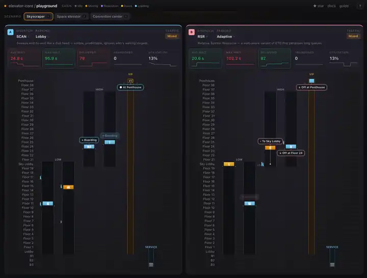

<div align="center">

# elevator-core

[](https://github.com/andymai/elevator-core/actions)
[](https://crates.io/crates/elevator-core)
[](https://docs.rs/elevator-core)
[](https://github.com/andymai/elevator-core/releases)
[](https://github.com/andymai/elevator-core/commits/main)
[](LICENSE-MIT)

A tick-based elevator simulation library for Rust, with no game engine dependency.\
Use it with Bevy, Unity, or your own renderer, or run it headless.

One engine and one API run a 5-story office or a space elevator.

[Guide](https://andymai.github.io/elevator-core/) · [API Reference](https://docs.rs/elevator-core) · [Examples](crates/elevator-core/examples/)

**[▶ Try the live playground](https://andymai.github.io/elevator-core/playground/)**: race two dispatch strategies side by side on the same traffic, in your browser.

</div>

<p align="center">
  
</p>

## What it does

You define stops at any positions on a 1-D axis, spawn riders, and call `step()`. The engine runs dispatch, trapezoidal motion, doors, boarding, and metrics. Your code reacts to the events.

```rust,no_run
use elevator_core::prelude::*;
use elevator_core::config::ElevatorConfig;

fn main() -> Result<(), SimError> {
    let mut sim = SimulationBuilder::new()
        .stop(StopId(0), "Lobby", 0.0)
        .stop(StopId(1), "Floor 2", 4.0)
        .stop(StopId(2), "Floor 3", 8.0)
        .elevator(ElevatorConfig { starting_stop: StopId(0), ..Default::default() })
        .build()?;

    sim.spawn_rider(StopId(0), StopId(2), 75.0)?;

    for _ in 0..1000 {
        sim.step();
        for event in sim.drain_events() {
            match event {
                Event::RiderExited { rider, tick, .. } => {
                    println!("Tick {tick}: rider {rider:?} delivered!");
                    return Ok(());
                }
                Event::RiderAbandoned { rider, stop, tick, .. } => {
                    eprintln!("Tick {tick}: rider {rider:?} abandoned at {stop:?}");
                    return Ok(());
                }
                _ => {}
            }
        }
    }
    eprintln!("timed out after 1000 ticks");
    Ok(())
}
```

The snippet above prints `Tick N: rider … delivered!` when the rider arrives. For a larger example with three riders and aggregate metrics, run:

```sh
cargo run --example basic -p elevator-core
# All riders arrived at tick 335!
# Delivered: 3
# Avg wait: 5.0 ticks
# Avg ride: 328.0 ticks
```

## Use cases

| Scenario                      | How                                        |
| ----------------------------- | ------------------------------------------ |
| Office building with 5 floors | Stops at 0, 4, 8, 12, 16                   |
| Skyscraper with sky lobbies   | Multi-group dispatch, express zones        |
| Space elevator                | Stops at 0 and 1,000, with the same engine |
| Player-controlled car         | `ServiceMode::Manual` + velocity commands  |
| Custom AI dispatch            | Implement `DispatchStrategy::rank()`       |
| VIP passengers, cargo, robots | Extension storage: attach any data         |

## Features

- **Stops at any position.** Floors do not need equal spacing, so you can model buildings, towers, and orbital tethers.
- **Pluggable dispatch.** Use a built-in strategy (SCAN, LOOK, Nearest Car, ETD, or Destination), or write your own with the `DispatchStrategy` trait.
- **Rider lifecycle.** Riders move through Waiting → Boarding → Riding → Exiting → Arrived/Abandoned, with hooks at each transition.
- **Extension storage.** Attach any typed data to riders, elevators, and stops.
- **O(1) population queries.** Find who waits, rides, or is resident at any stop.
- **Deterministic replay.** The same inputs give the same simulation each time.
- **Snapshot save and load.** Serialize the full simulation state for replays or networking.
- **Built-in metrics.** The engine records wait times, ride times, throughput, and delivered counts.

## Scope

By design, this library does not:

- **Render or draw elevators.** The core is headless. Use a host crate (`elevator-bevy`, `elevator-tui`, `elevator-wasm`), or connect your own renderer.
- **Model 2-D or n-D space.** Motion is 1-D only. The simulation has no floor plans, room geometry, or lateral movement.
- **Simulate building systems.** HVAC, power, occupancy models, and other building automation are out of scope.
- **Generate or manage traffic by itself.** The caller spawns each rider. The optional `traffic` feature adds Poisson helpers, but the simulation never spawns riders on its own.
- **Handle real-time networking or multiplayer.** Snapshot serialization supports replays and save and load. The caller owns authoritative multiplayer sync.

## Hosts

`elevator-core` itself is headless. Pick the host that matches your engine:

| Host                     | Crate                                     | Use it for                                          |
| ------------------------ | ----------------------------------------- | --------------------------------------------------- |
| Bevy                     | [`elevator-bevy`](crates/elevator-bevy)   | 2-D Rust game with HUD, mesh, and keyboard controls |
| Browser                  | [`elevator-wasm`](crates/elevator-wasm)   | wasm-bindgen surface that runs the live playground  |
| Unity / .NET / GameMaker | [`elevator-ffi`](crates/elevator-ffi)     | C ABI wrapper for native consumers                  |
| Godot                    | [`elevator-gdext`](crates/elevator-gdext) | gdext extension                                     |
| Terminal                 | [`elevator-tui`](crates/elevator-tui)     | tick-by-tick debugger and headless smoke runner     |

For an engine that is not on the list, call `Simulation::step()` from your own code. The API does not depend on an engine.

## Install

```toml
[dependencies]
elevator-core = "21"
```

Feature flags:

| Flag      | Default | Adds                                                            |
| --------- | ------- | --------------------------------------------------------------- |
| `traffic` | yes     | Poisson arrivals and daily traffic patterns. Depends on `rand`. |
| `energy`  | no      | Energy and regen model for each elevator.                       |

## Development

```sh
cargo run                                                            # default 5-stop building (Bevy)
cargo run -- assets/config/space_elevator.ron                        # 1,000 km orbital tether
cargo run -p elevator-tui -- assets/config/default.ron               # TUI debugger, interactive
cargo run -p elevator-tui -- assets/config/default.ron --headless --until 5000  # headless CI smoke
```

The workspace includes a [Bevy frontend](crates/elevator-bevy) (a 2-D renderer) and [`elevator-tui`](crates/elevator-tui). `elevator-tui` is a tick-by-tick debugger with pause and step controls, an event log, a dispatch summary, and snapshot save and load. See the [TUI Debugger guide](https://andymai.github.io/elevator-core/tui-debugger.html).

The supporting crates (`elevator-contract`, `elevator-layout-derive`, `elevator-layout-runtime`, `elevator-layout-codegen`) run only at build time or in tests. They keep the host bindings in sync. See [CLAUDE.md](CLAUDE.md#project-structure) for the full workspace layout.

## See also

- [Stability and Versioning](STABILITY.md): what counts as a breaking change, and what does not
- [`elevator-core` changelog](crates/elevator-core/CHANGELOG.md): release-please writes it
- [AI disclosure](AI-DISCLOSURE.md): how this repo uses AI tools

## License

[MIT](LICENSE-MIT) or [Apache 2.0](LICENSE-APACHE), at your option.
